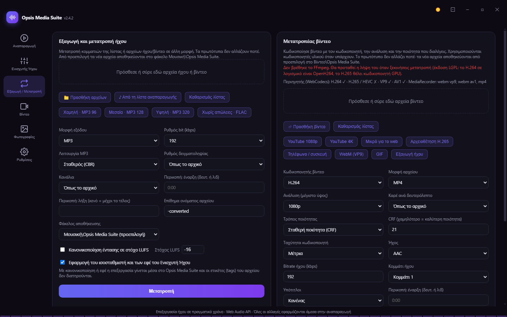
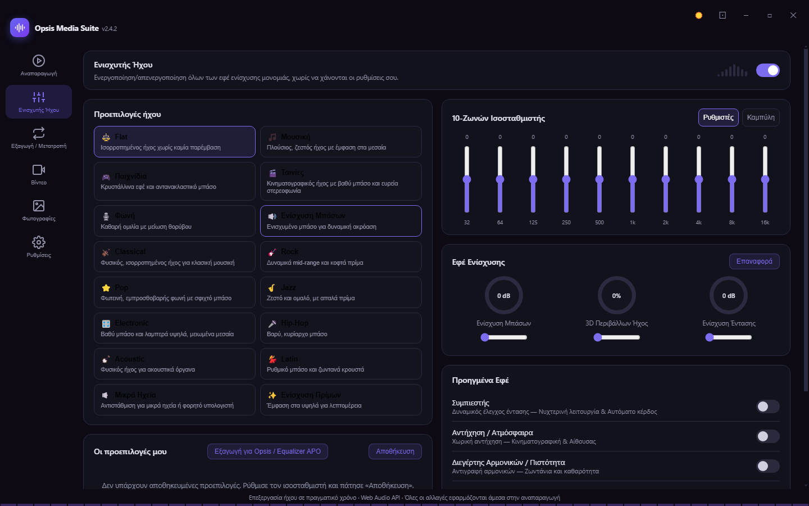
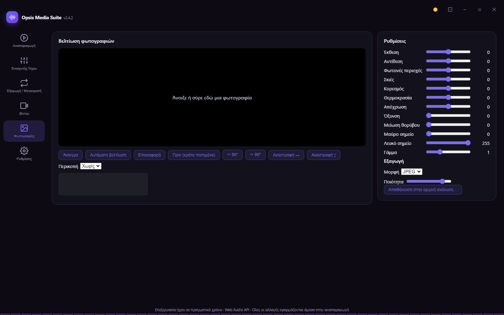
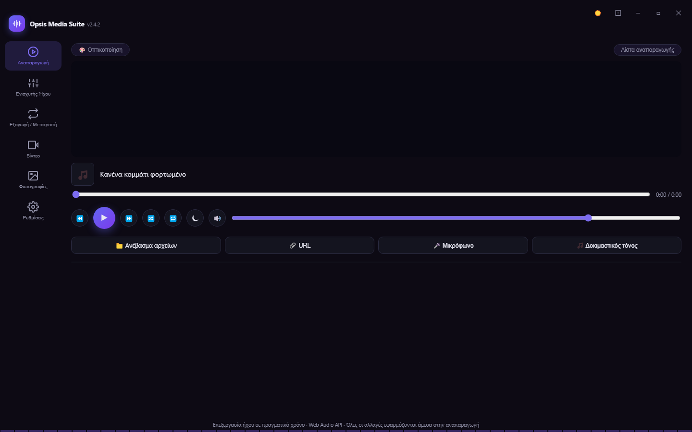
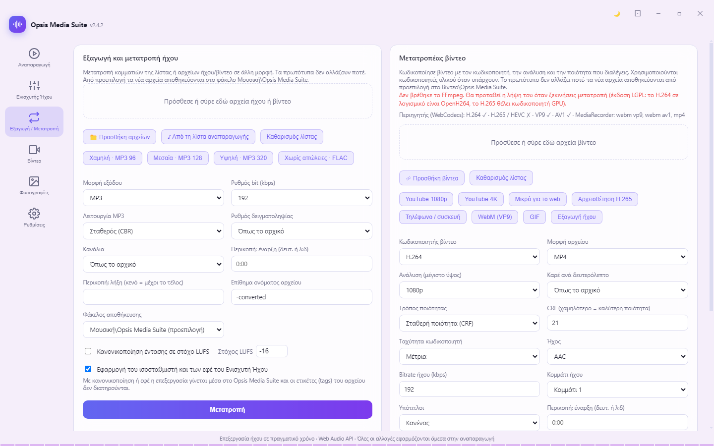
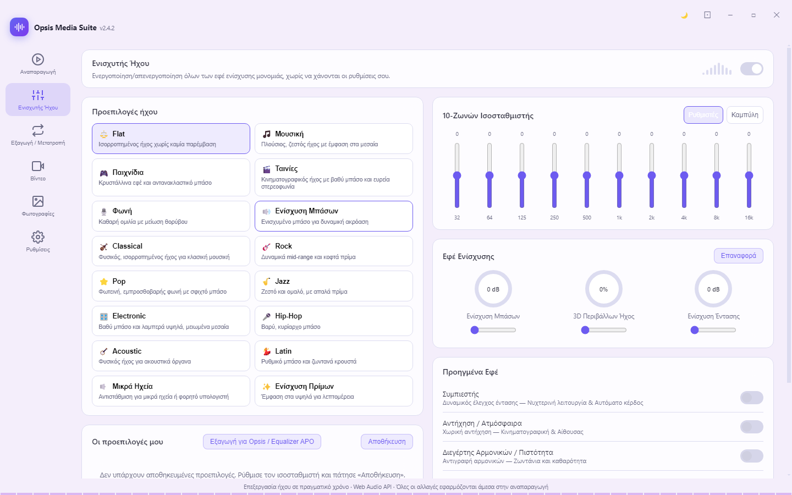
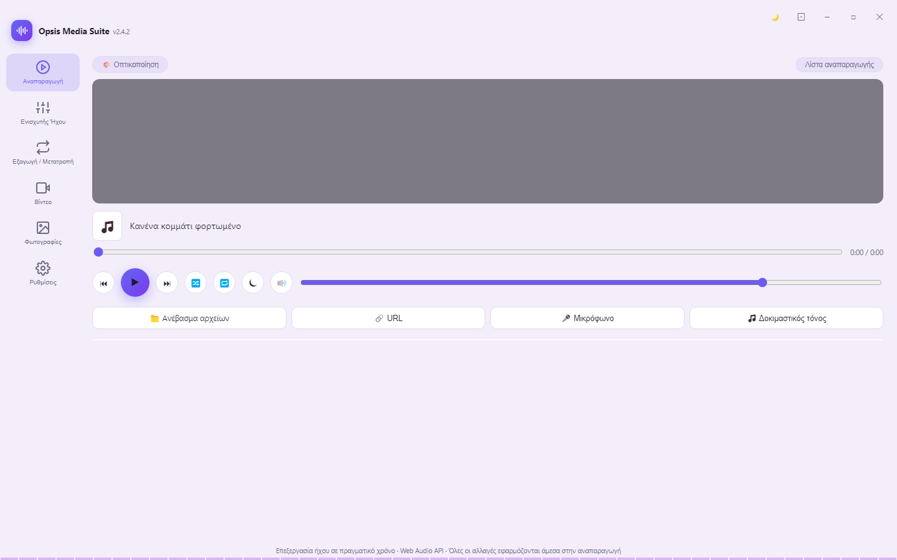
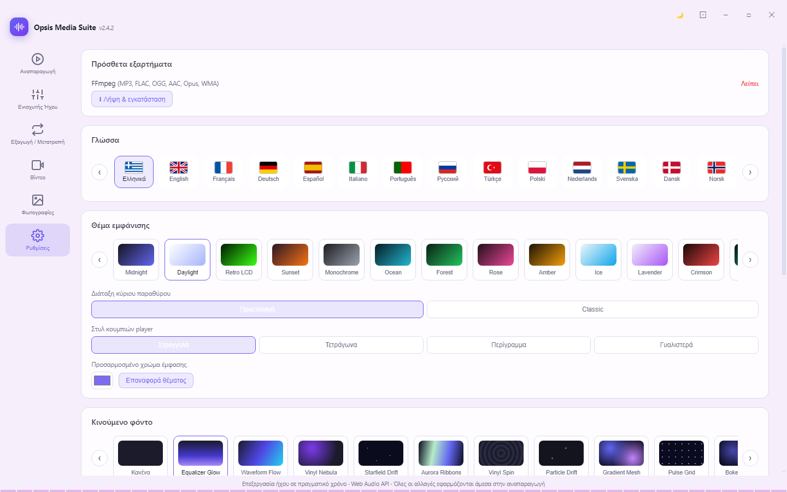
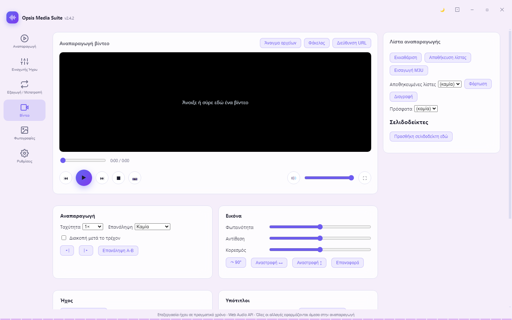

# Application screenshots / Στιγμιότυπα εφαρμογής

Source commit: e27f464a16c26868beab2d53b60da9bc69eab442

Actual Electron UI started through its package entrypoint, isolated empty media library, two themes. Not a playback or conversion test.

### 0-midnight-converter

### 0-midnight-enhance

### 0-midnight-photo

### 0-midnight-player

### 0-midnight-settings

### 0-midnight-video

### 1-light-converter

### 1-light-enhance

### 1-light-photo

### 1-light-player

### 1-light-settings

### 1-light-video

